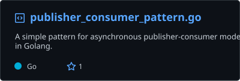

<h1 align="center">
  Hi, I'm Raihan 
</h1>

<h2 align="center">
  ⚡ Senior Platform Engineer
</h2>

<h3 align="center">
  🚀 Building Cloud-Native Platforms · 🧩 Automating Infrastructure · 🧠 Engineering with Agent-First philosophy
</h3>

👋 About Me

I'm a Senior Platform Engineer at [@MakroPro](https://www.linkedin.com/company/makropro), building cloud-native platforms, internal developer platforms (IDPs), Custom Kubernetes Operators and agent-first automation that helps engineering teams ship faster and operate reliably at scale.

I work at the intersection of Platform Engineering, Distributed Systems, Cloud Infrastructure, and AI-driven Engineering. My focus is transforming complex infrastructure and operational challenges into scalable, self-service platforms and intelligent automation.

🎯 My next frontier: Forward Deployed Engineering (FDE)

I want to bridge deep systems engineering with real-world customer problems, working close to users, integrating complex systems, and delivering production-ready solutions with measurable impact.

🛠️ What I Build

<table>
<tr>
<td width="50%" valign="top">

☸️ Platform Engineering

- Internal Developer Platforms (IDPs)

- Self-service infrastructure & golden paths

- Developer experience & service provisioning

- Policy-driven platform automation

</td>
<td width="50%" valign="top">

☁️ Cloud-Native Systems

- Kubernetes operators, controllers & CRDs

- Workload orchestration

- Multi-cloud infrastructure

- Production reliability & scalability

</td>
</tr>
<tr>
<td width="50%" valign="top">

🔄 GitOps & Automation

- Declarative infrastructure management

- Argo CD & continuous reconciliation

- Automated delivery workflows

- Infrastructure lifecycle automation

</td>
<td width="50%" valign="top">

⚙️ Backend & Distributed Systems

- Golang services and APIs

- Temporal workflow orchestration

- Event-driven architectures

- Resilient, observable systems

</td>
</tr>
<tr>
<td width="50%" valign="top">

🤖 Agent-First Engineering

- AI-powered developer tooling

- Code intelligence & automated analysis

- Production diagnostics and RCA

- Engineering workflow automation

</td>
<td width="50%" valign="top">

🎯 Forward Deployed Engineering

- Turning ambiguous problems into solutions

- Integrating software with real environments

- Rapid prototyping and production delivery

- Connecting engineering outcomes to business impact

</td>
</tr>
</table>

🚀 Production-Grade Engineering

<b>☸️ KubeDB · Kubernetes-Native Database Automation</b>

Building and working with Kubernetes-native database lifecycle management, automation, and cloud-native infrastructure.

<b>🏗️ Makro Pro · Internal Developer Platform</b>

Building self-service infrastructure and GitOps-driven workflows across cloud environments, helping engineering teams provision services and manage delivery through standardized platform capabilities.

<b>🕵️ Agentic Developer Tooling</b>

Exploring AI agents for code intelligence, Agentic Jira Automation, automated code review, engineering workflows, production diagnostics, and root cause investigation.

<h3 align="left">Find Me On:</h3> 

    <a href="https://raihankhan.github.io/">
        
     
    
    
    

<h3 align="left">Connect with me:</h3> 

    
    

📫 - shoot an email at <b>raihankhanraka@gmail.com</b>

## 🧰 Technology Stack & Engineering Toolkit

### ☸️ Platform Engineering & Kubernetes

  
  
  
  
  
  
  
  
  

### 🔄 GitOps & CI/CD

  
  
  
  
  

### ☁️ Cloud & Infrastructure as Code

  
  
  
  
  
  
  
  
  
  

### 📦 Containers, Networking & Service Infrastructure

  
  
  
  
  
  
  
  
  

### 📈 SRE, Observability & Production Reliability

  
  
  
  
  
  
  
  
  
  
  
  

### 🔐 DevSecOps, Security & Identity

  
  
  
  
  
  
  
  
  
  

### 🧠 AI Engineering, LLMs & Agentic Systems

  
  
  
  
  
  
  
  
  
  
  

### 🗄️ Data, Messaging & Workflow Orchestration

  
  
  
  
  
  
  
  
  

### 💻 Backend, APIs & Software Engineering

  
  
  
  
  
  
  
  
  
  
  
  

### 🧪 Testing, Developer Tooling & Engineering Productivity

  
  
  
  
  

### 🖥️ Developer Environment & Collaboration

  
  
  
  
  
  
  
  
  
  
  
  

---

### Stats

    

### Gists

 
  
